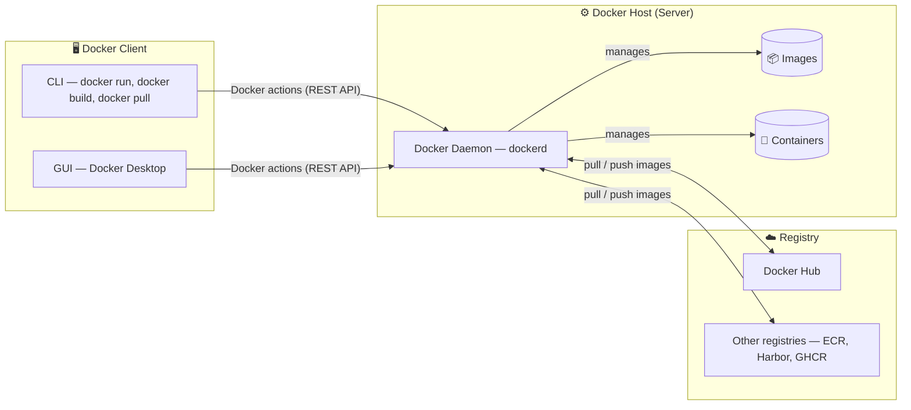
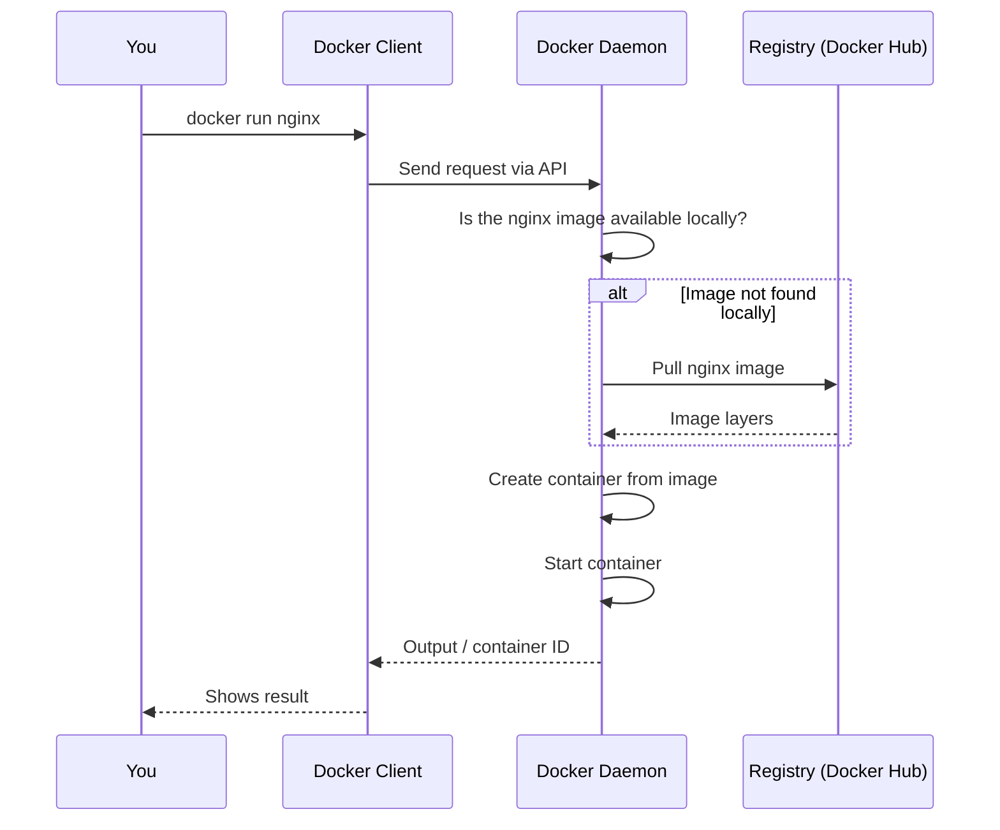

# 🏛️ 02 — Docker Architecture: Client · Daemon · Registry

Docker uses a **client–server architecture**. You type commands into a **client**, the client sends them to the **Docker daemon** (the server), and the daemon does the real work: building images, running containers, and talking to registries.

The animation above shows `docker run nginx` end to end. Below is the same architecture as a static diagram:

---

## 🧩 The Components

### 1. Docker Client

- The tool you interact with. Usually the `docker` command in the terminal (CLI), or Docker Desktop (GUI).
- It does **not** run containers itself. It converts your command into an API request and sends it to the daemon.
- It can talk to a daemon on the same machine or on a remote one.

### 2. Docker Daemon (`dockerd`)

- The background service that does the work.
- Listens for API requests from the client.
- Manages Docker objects: **images, containers, networks, volumes**.
- Pulls images from registries and pushes them back.
- On Linux it normally runs as a systemd service, and the client talks to it over a Unix socket: `/var/run/docker.sock`.

### 3. Docker Registry

- A storage and distribution service for images.
- **Docker Hub** is the default public registry.
- Others: AWS ECR, GitHub Container Registry, Harbor (self-hosted), and more.
- `docker pull` downloads from a registry, and `docker push` uploads to one.

---

## 📦 Docker Objects

| Object | What it is |
|--------|------------|
| **Image** | Read-only template with the app and its dependencies, built in layers |
| **Container** | A running (or stopped) instance of an image |
| **Network** | Lets containers talk to each other and the outside world (Phase 4) |
| **Volume** | Persistent storage that outlives a container (Phase 5) |

---

## 🔄 What Happens When You Run `docker run nginx`?

Step by step:

1. The **client** sends the `run` request to the daemon.
2. The **daemon** checks whether the `nginx` image exists locally.
3. If not, it **pulls** the image from the registry (Docker Hub by default).
4. The daemon **creates** a container from the image.
5. The daemon **starts** the container and returns the result to the client.

---

## 🔬 Under the Hood (good to know)

Docker Engine is built from several pieces:

| Component | Role |
|-----------|------|
| `dockerd` | The Docker daemon, which handles the API and image management |
| `containerd` | High-level container runtime that manages the container lifecycle |
| `runc` | Low-level runtime that actually creates the container using Linux kernel features |

Linux kernel features that make containers possible:

- **Namespaces** give isolation (each container sees its own processes, network, filesystem).
- **cgroups** limit resources (CPU, memory) per container.

---

## ✅ Summary

- Docker is **client → daemon → registry**.
- The client sends commands, the daemon does the work, and the registry stores images.
- Docker manages four main objects: images, containers, networks, volumes.
- `docker run` = pull image (if needed) → create container → start container.

⬅️ Previous: [01 — What is Docker](01-what-is-docker.md)
➡️ Next: [03 — Installation on Ubuntu](03-installation-ubuntu.md)
